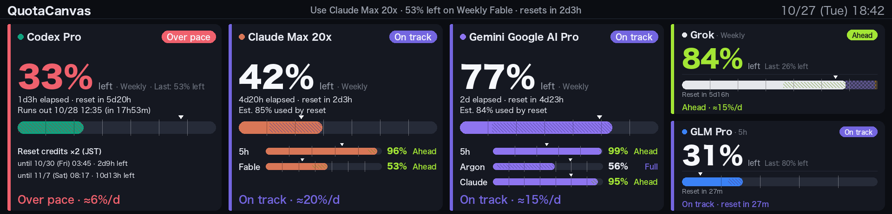

# quota-canvas

[日本語](README.md) | English

A macOS tool that displays remaining quota and usage pace for Claude, Codex, GLM, Grok, and Gemini on a TURZX 9.2" USB screen. It consists of a Python engine and a menu bar app in `app/`.



## Supported display / Where to buy

TURZX 9.2-inch USB secondary screen, 1920×462 IPS. A single USB Type-C cable supplies power and data. macOS sees it as a USB device named `TURZX1.0` (VID `0x1cbe` / PID `0x0092`), not as a display. No dedicated driver is required; communication uses `libusb`.

[Buy on AliExpress](https://s.click.aliexpress.com/e/_c3EptWGn) (tested by the author)

**Affiliate link (advertisement):** the author receives a commission based on purchases, at no extra cost to you.

Screens that look identical can have different internal specifications, including the PID. Other listings are not guaranteed to work.

## Install from DMG

On Apple Silicon with macOS 14 or later, open the DMG from [Releases](https://github.com/digimaga/quota-canvas/releases) and drag QuotaCanvas.app to Applications. No Homebrew or Python installation is needed. The app is ad-hoc signed: on first launch, right-click and choose Open, or allow it under System Settings > Privacy & Security.

In Display settings, control the bundled background engine and TURZX screen. If a repository LaunchAgent exists, the bundled engine will not start automatically.

To build the DMG, install Swift Command Line Tools, then run `cd app && ./scripts/build.sh && ./scripts/make-dmg.sh`. The output is in `app/build/`. For a development build without the engine, use `./scripts/build.sh --no-engine`.

To uninstall, turn off “Run the engine in the background” in settings before deleting the app. If the app was deleted first, use `launchctl bootout` on each label in `~/Library/LaunchAgents/com.digimaga.quota-canvas.app*.plist`, then delete those plists.

## Manual setup

```bash
./scripts/setup.sh
```

This installs Homebrew's `libusb` and the package in `.venv`. No sudo is required.

## turzx: Displaying images

```bash
.venv/bin/turzx test                 # test pattern for checking orientation
.venv/bin/turzx show picture.png     # scale and crop a landscape image to 1920×462
.venv/bin/turzx brightness 80        # brightness from 0 to 100
.venv/bin/turzx sync                 # connection check; prints the reply in hex ("turzx_0001_0015" in ASCII)
```

From Python:

```python
from turzx import Screen
Screen().show(pil_image)   # 1920×462 landscape image
```

Images are sent as PNG. The device expects a **portrait 462×1920** frame; `show` rotates a landscape 1920×462 image by `--rotation` (90 degrees by default). Sending 1920×462 or 480×1920 directly distorts the display. Use `show-raw` to send a portrait image without rotation.

## QuotaCanvas: Displaying quotas

QuotaCanvas fetches usage and shows whether the current pace will exhaust a quota before its reset.

```bash
.venv/bin/quota-canvas once                     # fetch and display once
.venv/bin/quota-canvas run                      # fetch every 15 minutes, redraw every minute
.venv/bin/quota-canvas --no-screen --out a.png once   # save a PNG without sending it to the screen
.venv/bin/quota-canvas --only claude:weekly codex:weekly once   # select windows to display
.venv/bin/quota-canvas config                   # show effective settings and window IDs
.venv/bin/quota-canvas config --init            # create a config file from the template
.venv/bin/quota-canvas detect --json            # show available services, plans and windows
.venv/bin/quota-canvas set-key glm              # save a GLM API key in Keychain
.venv/bin/quota-canvas pick                     # show a recommendation (--json is also available)
./scripts/install-agent.sh                      # start at login; --uninstall removes it
./scripts/install-auto-update.sh                # pull new main commits every 10 minutes and restart; --uninstall removes it
```

### Configuration and app integration

The config file is `~/.config/quota-canvas/config.toml`; see [config.example.toml](config.example.toml) for the template. Defaults apply if the file is absent, and `run` reloads changes automatically. Key settings:

- `display.windows` selects and orders windows; `display.brightness` / `display.night` control brightness and night dimming; `display.paused` pauses the screen. `display.sleep_with_mac` (default true) turns the screen off and restores it with the Mac; usage is not fetched while asleep. `display.gauge` is `"remaining"` or `"used"`.
- `poll` controls fetch and redraw intervals; `pacing` controls pace thresholds. `pacing.sleep` can judge pace using waking hours, and `pacing.sleep.advice = "bedtime"` shows time until bedtime in the advice.
- `providers.*.enabled` / `providers.*.windows` enable services and select their windows; an empty `[]` means all windows. `--only` / `--interval` / `--redraw` override the config, and `--config PATH` selects another config file.

See [docs/app-contract.md](docs/app-contract.md) for menu bar app integration. On every redraw, `run` atomically writes `status.json` and `frame.png` under `~/Library/Application Support/quota-canvas/`. While `display.paused = true`, it sends nothing to the screen and updates only `status.json`. The app controls the engine via `detect --json` / `config --json` / `config --set-json` / `set-key` / `refresh`.

`quota-canvas refresh` creates `refresh-request` in that directory. `run` detects it within one second and redraws; it also fetches usage again if at least 30 seconds have elapsed since the last fetch. Saving the config also updates the screen within 1–2 seconds.

### Menu bar app

[app/](app/) contains QuotaCanvas.app, which displays engine status, recommendations and a screen preview, and provides settings, pause and notifications. With Swift 6.2 or later and macOS 14 or later, run `cd app && ./scripts/build.sh` to build `app/build/QuotaCanvas.app`. See [app/README.md](app/README.md).

The Routing settings tab enables routing, sets the remaining quota floor and data freshness, shows current verdicts, toggles burn mode, and edits and reorders workers and their windows. It also provides copy buttons for the Claude Code / Codex plugin installation commands.

### Credentials

- Claude reads Keychain `Claude Code-credentials`, Codex reads `~/.codex/auth.json`, and Grok reads `~/.grok/auth.json`. GLM checks Keychain `quota-canvas/glm`, then `ZAI_API_KEY`, `~/.config/glm-run/zai_api_key`, and `~/.dsh/.credentials.yaml`. A key saved with `set-key glm` takes priority.
- Token refresh is delegated to each CLI. With the default `providers.claude.token_refresh = "cli"`, Claude runs `claude -p` once in the background when the token is near expiry or on HTTP 401/403, at most once per 30 minutes. `"off"` disables this and prompts the user to launch Claude on 401/403. `providers.grok.token_refresh` runs `grok models` on expiry or HTTP 401/403 without consuming quota. `providers.codex.token_refresh` runs `codex exec … ok` on HTTP 401/403, at most once per 30 minutes; it consumes a little quota.
- Gemini uses Antigravity CLI's `agy -p "/usage" --output-format json`. This does not invoke a model or consume quota, and agy refreshes its own token. `providers.gemini.token_refresh` is accepted for compatibility but is no longer used. The windows are `gemini:weekly`, Gemini 4 Argon's `gemini:argon`, `gemini:5h`, and `gemini:claude` / `gemini:claude_5h` for Claude / GPT through Antigravity. The plan name is shown if it can be obtained with the Keychain token for service `gemini` / account `antigravity`; otherwise it is shown as “Gemini”.

### History, pace and recommendations

- Eight days of history are stored in `~/Library/Application Support/quota-canvas/history.jsonl`, for daily bar charts and the last 24 hours' rate. Days before history began show “?”.
- Pace prediction blends the whole-window average and recent rate equally. Reaching 100% before reset means over pace; projected use of at least 92% at reset is tight, at least 70% is on track, and less is spare. Less than 3% elapsed and less than 5% used is fresh. If usage rose by at least 1% in the last two hours, the rate is at least 1.5 times the blended rate, and it would exhaust the quota before reset, yellow advice shows the projected exhaustion time. Advice also mentions another window of the same service, such as a five-hour window, if it runs out first. Wording is determined by `advice_text()` in `src/quotacanvas/render.py`.
- The English display labels the spare state `Spare` and the tight state `Maxing out`.
- On each reset, the final usage is saved in `periods.jsonl` (the latest 20 per window) and the next period's card shows the previous remaining amount.
- The header and `pick` recommend a service to use now. The score is the amount projected to expire unused × window length ÷ time until reset. Services that are over pace, below 5% remaining, failing to fetch, or waiting for reset are excluded; the score is halved when a window shorter than a day has less than 20% remaining and multiplied by 1.5 for a Codex reset credit expiring within 24 hours. If `status.json` is absent or more than 20 minutes old, `pick` fetches usage once without sending anything to the screen.

## AI worker routing

To make better use of multiple AI subscriptions, routing gives coding agents quota and pace information for choosing which worker or model to use. The verdict is informational: the engine does not start or stop workers itself. Routing is OFF by default.

### Enabling and defining workers

Add settings like these to `config.toml`. Use `config` to find window IDs.

```toml
[routing]
enabled = true
floor_percent = 5
floor_hours = 24
stale_minutes = 20
# short_over_margin_minutes = 30   # defaults to 10% of the window length

[routing.workers]
claude = ["claude:*"]
gemini = ["gemini:weekly", "gemini:5h"]
argon = ["gemini:argon"]
```

Each worker is a list of window IDs; a trailing `*` matches a prefix. Configuration order determines `routing line` order. Breakdown windows (`part_of`) are excluded. If `[routing.workers]` is absent or empty, each fetched provider becomes one worker containing all its independent windows. The default `gemini` worker also includes Argon and Claude / GPT through Antigravity; define workers explicitly to split them. The worst verdict among a worker's matched windows wins; ties use the window with less remaining quota.

Worker names use 1–40 ASCII letters, digits, `.`, `_`, or `-`. `config --json` also returns the display order in `routing.worker_order`. `config --set-json` accepts `routing.workers` as an array of `{"name": ..., "windows": [...]}` objects, whose order takes priority; for an object, `worker_order` can specify the order.

### Verdicts

| Verdict | Meaning and conditions |
| --- | --- |
| `stop` | Exhausted, or remaining quota is below `floor_percent` (default 5%). The low-remaining `stop` applies only to windows whose reset is at least `floor_hours` (default 24 hours) away, or whose reset time is unknown (`floor_hours = 0` applies it always). |
| `reserve` | Over pace and projected to run out before reset; prefer another worker if possible. Short windows have an exception (below). |
| `go` | On track (windows of 24 hours or longer) or nearly fully used by reset. Also used when the window's pace status itself is unknown. |
| `boost` | Quota is projected to remain unused, the window has just reset, a window shorter than 24 hours is on track, or burn mode is active; a candidate for active use. |
| `unknown` | No matching window, provider fetch error, stale data, or another reason prevents a judgment. Fail-open: do not block startup. |

**Windows shorter than 24 hours** (such as 5-hour windows) do not carry over, so ideally they are used up exactly at reset. With a margin of `short_over_margin_minutes` (default: 10% of the window length, i.e. 30 minutes for a 5-hour window), an over-pace window is `go` when it is projected to run out less than the margin before reset, and `reserve` when it would run out earlier. Once a window becomes `reserve`, it stays `reserve` for the same reset until the gap drops below two thirds of the margin (recorded in `routing.holds` in `status.json` to avoid flapping). The low-remaining `stop` applies only while the reset is at least the margin away; after that the window is used down to 0%.

The default freshness limit is 20 minutes (`stale_minutes`). An old `fetched_at` or `stale_error` on a window of a relevant provider also makes the worker `unknown`. Reset credit counts are displayed but do not change verdicts.

### Commands

```bash
.venv/bin/quota-canvas routing line                  # one-line verdict summary
.venv/bin/quota-canvas routing line --json           # JSON output
.venv/bin/quota-canvas routing check gemini          # check one worker
.venv/bin/quota-canvas routing check gemini --json   # JSON output
.venv/bin/quota-canvas routing burn                  # list active burn modes
.venv/bin/quota-canvas routing burn --json           # list as JSON
.venv/bin/quota-canvas routing burn gemini on        # enable until 23:59 today
.venv/bin/quota-canvas routing burn gemini on --until 18:00  # HH:MM or ISO 8601
.venv/bin/quota-canvas routing burn gemini off       # disable
.venv/bin/quota-canvas routing hook                  # JSON for SessionStart
```

`line` and `check` read `~/Library/Application Support/quota-canvas/status.json`; they do not fetch usage from services. When enabled, `run` writes `routing`, including its `line`, to `status.json`. `line` always exits 0 and is silent when disabled. `check` exits 3 for `stop` and 0 otherwise. Normally, `stop` / `reserve` / `unknown` print a note to stderr, while `go` / `boost` are silent. With `--json`, the verdict is printed to stdout with the same exit codes. It is also silent and exits 0 when disabled. An invalid name exits 2; valid names are known provider names or configured worker names. `QUOTA_GATE_FORCE=1` bypasses `check`. Use `--status PATH` / `QUOTA_STATUS_PATH` for the primary file and `--fallback-status PATH` / `QUOTA_STATUS_FALLBACK` for a backup when the primary cannot be used.

While active, burn mode turns `reserve` / `go` / `boost` into `boost`, but leaves `stop` and `unknown` unchanged. Its state is saved in `routing-burn.json` in the same directory. When workers are explicitly configured, `on` accepts only their names. An active entry can still be cleared with `off` after its name has been removed from the configuration. A past `--until` time in HH:MM form means that time tomorrow; a past ISO 8601 time is an error (exit code 2). `burn --json` returns the active entries as JSON for both listing and after a change.

`hook` reads the same data as `line` and prints one JSON line containing `additionalContext` with the verdict and short routing rules. If the data is missing, stale, or broken, it reports only that the verdict is unavailable. It prints nothing when disabled, when there are no workers, or when configuration or evaluation fails, and always exits 0. `--event NAME` changes the event name in the JSON; the default is `SessionStart`.

### Using routing with an agent

The bundled [quota-canvas-routing plugin](plugins/quota-canvas-routing/README.md) adds the verdict and routing rules to Claude Code / Codex context at SessionStart. On macOS, install and run the engine and enable routing as above, then install the plugin.

In Claude Code:

```text
/plugin marketplace add digimaga/quota-canvas
/plugin install quota-canvas-routing@quota-canvas
```

For Codex:

```bash
codex plugin marketplace add digimaga/quota-canvas
codex plugin add quota-canvas-routing@quota-canvas
```

Codex does not run the hook until it is trusted. Commands such as `codex exec` silently skip untrusted hooks, so trust it in an interactive Codex session after installation and again if a plugin update changes the hook. The hook looks for the executable in `QUOTA_CANVAS_BIN`, then PATH, then `~/dev/quota-canvas/.venv/bin/quota-canvas`. If it cannot find it or routing is disabled, it prints nothing and does not block session startup.

Alternatively, add the following to Claude Code's `settings.json` to include only the one-line verdict in the model's context without the plugin. Replace `/path/to/quota-canvas` with the actual absolute path to this repository and merge with existing hooks if necessary. See the [Claude Code hooks reference](https://code.claude.com/docs/en/hooks).

```json
{
  "hooks": {
    "SessionStart": [
      { "hooks": [
        { "type": "command", "command": "\"/path/to/quota-canvas/.venv/bin/quota-canvas\" routing line" }
      ] }
    ]
  }
}
```

Before starting a worker, check the exit code in the launcher. Replace `worker-command` with your worker's launch command:

```bash
if .venv/bin/quota-canvas routing check gemini; then
  worker-command
else
  echo "routing check failed; worker was not started" >&2
fi
```

This example also prevents startup on other nonzero exits, such as an invalid name. `unknown` exits 0, so it continues. Putting `check` in SessionStart alone does not make exit code 3 block Claude Code startup.

In an agent instruction file such as `CLAUDE.md` or `AGENTS.md`, you can write: “Prefer `boost` workers, do not use `stop` workers, and prefer another worker over `reserve` when possible.” This is an instruction to the agent; use `check` in the launcher to block a `stop` worker.

## License

MIT ([LICENSE](LICENSE)). TURZX communication uses [phstudy/turing-smart-screen-cli](https://github.com/phstudy/turing-smart-screen-cli) (MIT), pinned to a commit. The quota display was inspired by [nuitsjp/token-dashboard](https://github.com/nuitsjp/token-dashboard) for Windows.
