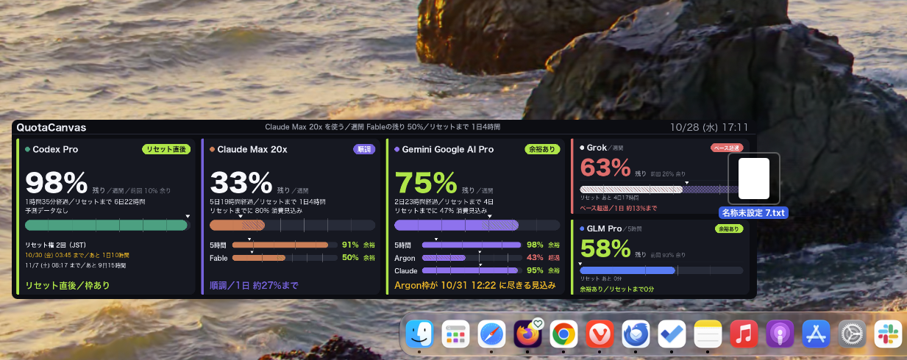
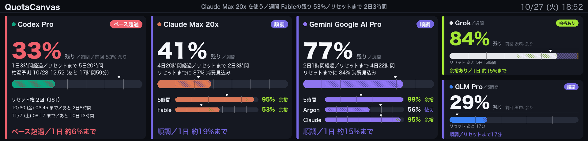

# quota-canvas

[English](README.md) | 日本語

Claude / Codex / GLM / Grok / Gemini / OpenRouter / DeepSeek / Kimi の利用枠の残量とペースを、Mac のデスクトップやメニューバー、または任意の TURZX 9.2" USB 画面に表示する macOS アプリ。



壁紙のようにデスクトップに埋め込まれ、アイコンはその上に、ウィンドウはいつも通り手前に出る。

## できること

- パネルをデスクトップに埋め込み、表示するディスプレイ・8 か所の位置・幅・不透明度・アイコンの手前 / 奥を選べる。
- メニューバーで推薦、利用枠のカード、Codex のリセット権を確認できる。
- 利用枠の状態を通知する。
- 利用ペース、枯渇予測、履歴を表示する。
- Claude Code / Codex プラグインで、残量とペースに基づく AI ワーカーの振り分けを支援する（上級者向け）。

## 対応サービス

| サービス | 表示する内容 | 必要な認証 |
| --- | --- | --- |
| Claude | 5 時間・週間・モデル別週間の利用枠 | ログイン済み Claude Code のキーチェーン認証情報 |
| Codex | 利用枠とリセット権 | ログイン済み Codex CLI の認証情報 |
| GLM | トークン利用枠 | キーチェーンの API キーまたは `ZAI_API_KEY` |
| Grok | 利用枠と製品別内訳 | ログイン済み Grok CLI の認証情報 |
| Gemini | Antigravity の週間・5 時間枠（Argon、Claude / GPT を含む） | Antigravity CLI（`agy`）のログイン |
| OpenRouter | API キーの利用枠または利用額 / 上限残額、取得できる場合はアカウントのクレジット残高 | キーチェーンの API キーまたは `OPENROUTER_API_KEY` |
| DeepSeek | アカウント残高 | キーチェーンの API キーまたは `DEEPSEEK_API_KEY` |
| Kimi | グローバル版 USD アカウント残高 | キーチェーンの Moonshot API キーまたは `MOONSHOT_API_KEY` |

OpenRouter / DeepSeek / Kimi は公開 API 仕様に基づく実装で、実アカウントでは未検証。詳しくは[認証情報](#認証情報)を参照。

## DMG からインストール

Apple Silicon、macOS 14 以上に対応。Homebrew や Python のインストールは不要。

1. [Releases](https://github.com/digimaga/quota-canvas/releases) から最新の `QuotaCanvas-<バージョン>.dmg` をダウンロードする。
2. DMG を開き、QuotaCanvas.app を隣の「Applications」フォルダにドラッグする。
3. 「アプリケーション」フォルダから QuotaCanvas を開く。Apple の公証を受けていないため、初回は「開発元を確認できません」などと出て開けない。次の手順で許可する。
   - macOS 15 以降: 「システム設定 > プライバシーとセキュリティ」を開き、下の方にある QuotaCanvas の「このまま開く」を押す。
   - macOS 14: Finder で QuotaCanvas を右クリックして「開く」を選ぶ。
4. メニューバーにゲージのアイコンが出る。「設定… > サービス」で表示するサービスを選び、API キーが要るサービスはキーを入れる。
5. 「設定 > デスクトップ」で「デスクトップに表示」をオンにする。TURZX 画面を使わない場合は「設定 > 表示」で「TURZX 画面を使う」をオフにする。任意の TURZX 画面を使う場合は [TURZX 画面](#turzx-画面任意) を参照。

更新するときは、新しい DMG の QuotaCanvas.app を同じように Applications へドラッグして置き換える。

設定の「表示」で同梱エンジンの常駐と TURZX 画面の使用を切り替えられる。リポジトリ版 LaunchAgent が残っている場合、同梱エンジンは自動起動しない。

DMG をビルドするには Swift Command Line Tools を用意し、`cd app && ./scripts/build.sh && ./scripts/make-dmg.sh` を実行する。成果物は `app/build/` に作られる。エンジンを同梱しない開発用ビルドは `./scripts/build.sh --no-engine`。

アンインストールは、設定で「エンジンを常駐させる」をオフにしてからアプリを削除する。オフにせず削除した場合は `~/Library/LaunchAgents/com.digimaga.quota-canvas.app*.plist` の各ラベルを `launchctl bootout` で停止してから plist を削除する。

## TURZX 画面（任意）



TURZX 9.2 インチ USB セカンダリースクリーン（1920×462 IPS）。USB Type-C ケーブル 1 本で給電と通信を行う。macOS のディスプレイとしては認識されず、USB 機器「TURZX1.0」（VID `0x1cbe` / PID `0x0092`）として扱う。専用ドライバーは不要で、通信には `libusb` を使う。

[AliExpress で購入する](https://s.click.aliexpress.com/e/_c3EptWGn)（作者の手元で動作確認済み）

※ アフィリエイトリンク（広告）。購入額に応じて作者に紹介料が入り、購入価格は変わらない。

同じ見た目でも PID など内部仕様が異なる個体があり得るため、別の出品の動作は保証しない。

画面を使うには USB で接続し、「設定 > 表示」で「TURZX 画面を使う」をオンにする。1 分ほどで残量が表示される。

## 上級者向け

### 手動セットアップ

```bash
./scripts/setup.sh
```

Homebrew の `libusb` を入れ、`.venv` にこのパッケージをインストールする。sudo は不要。

### turzx：画像を表示する

```bash
.venv/bin/turzx test                 # 向き確認用のテストパターン
.venv/bin/turzx show picture.png     # 横長画像を表示（1920×462 に合わせて拡大・切り抜き）
.venv/bin/turzx brightness 80        # 明るさ 0〜100
.venv/bin/turzx sync                 # 接続確認（応答を 16 進で表示。ASCII では "turzx_0001_0015" を含む）
```

Python から使う場合:

```python
from turzx import Screen
Screen().show(pil_image)   # 1920×462 の横長画像
```

画像は PNG で送る。デバイスが受け取るのは **縦向き 462×1920** のフレームで、`show` は横長 1920×462 の画像を `--rotation`（既定 90 度）だけ回転させる。1920×462 や 480×1920 をそのまま送ると表示が崩れる。縦向きの画像を回転なしで送るときは `show-raw` を使う。

### QuotaCanvas：利用枠の表示

利用枠を取得し、今のペースで使い続けるとリセット前に尽きるかを表示する。

```bash
.venv/bin/quota-canvas once                     # 1 回取得して表示
.venv/bin/quota-canvas run                      # 15 分ごとに取得・1 分ごとに再描画
.venv/bin/quota-canvas --no-screen --out a.png once   # 画面に送らず PNG だけ
.venv/bin/quota-canvas --only claude:weekly codex:weekly once   # 表示する枠を絞る
.venv/bin/quota-canvas config                   # 実際に使われる設定と窓 ID の一覧
.venv/bin/quota-canvas config --init            # 設定ファイルをひな形から作成
.venv/bin/quota-canvas detect --json            # 使えるサービスとプラン/窓を表示
.venv/bin/quota-canvas set-key glm              # GLM の API キーをキーチェーンに保存
.venv/bin/quota-canvas set-key openrouter       # OpenRouter の API キー
.venv/bin/quota-canvas set-key deepseek         # DeepSeek の API キー
.venv/bin/quota-canvas set-key kimi             # Moonshot の API キー
.venv/bin/quota-canvas pick                     # 今使う先を 1 行で表示（--json も可）
./scripts/install-agent.sh                      # ログイン時に自動起動（--uninstall で解除）
./scripts/install-auto-update.sh                # 10 分ごとに main の新しい commit を取り込み、常駐を再起動（--uninstall で解除）
```

#### 設定とアプリ連携

設定ファイルは `~/.config/quota-canvas/config.toml`、ひな形は [config.example.toml](config.example.toml)。ファイルがなければ既定値を使い、`run` 中の変更は自動で読み直す。主な設定は次のとおり。

- `display.windows` は表示する窓の選択・順序、`display.brightness` / `display.night` は明るさと夜間減光、`display.paused` は一時停止。`display.sleep_with_mac`（既定 true）は Mac のスリープに合わせて画面を消灯・復帰し、スリープ中は取得しない。`display.gauge` は `"remaining"`（残量）または `"used"`（使用量）。
- `poll` は取得・再描画間隔、`pacing` はペース判定の閾値。`pacing.sleep` で睡眠帯を除いた起きている時間を基準にでき、`pacing.sleep.advice = "bedtime"` ならアドバイスの残り時間を寝るまでで表示する。
- `providers.*.enabled` / `providers.*.windows` でプロバイダの有効・無効と表示する窓を指定する。窓が空の `[]` なら全部。`--only` / `--interval` / `--redraw` は設定ファイルより優先し、`--config PATH` で設定の場所を変えられる。

メニューバーアプリとの連携は [docs/app-contract.md](docs/app-contract.md) を参照。`run` は再描画のたびに `~/Library/Application Support/quota-canvas/` へ `status.json` と `frame.png` を原子的に書く。`display.paused = true` の間は画面に送らず、`status.json` だけを更新する。アプリは `detect --json` / `config --json` / `config --set-json` / `set-key` / `refresh` でエンジンを操作する。

`quota-canvas refresh` は同ディレクトリに `refresh-request` を作る。`run` が 1 秒以内に検知して再描画し、前回の取得から 30 秒以上経過していれば利用量も取り直す。設定の保存も 1〜2 秒で画面に反映される。

#### メニューバーアプリ

[app/](app/) の QuotaCanvas.app はエンジンの状態、推奨、画面プレビューを表示し、設定や一時停止、通知を操作できる。Swift 6.2 以上と macOS 14 以上で、`cd app && ./scripts/build.sh` により `app/build/QuotaCanvas.app` をビルドする。詳しくは [app/README.md](app/README.md)。

設定の「振り分け」タブでは、判定の有効化、残量の下限とデータの鮮度の設定、現在の判定の確認、使い切りモードの切り替え、ワーカーと窓の編集・並べ替えができる。Claude Code / Codex 用プラグインのインストールコマンドもコピーできる。

#### 認証情報

- Claude はキーチェーン `Claude Code-credentials`、Codex は `~/.codex/auth.json`、Grok は `~/.grok/auth.json` を読む。GLM はキーチェーン `quota-canvas/glm`（`set-key glm` またはアプリの設定で保存）か環境変数 `ZAI_API_KEY` を読む。キーチェーンのキーが最優先。
- トークンの更新は各 CLI に任せる。Claude は既定の `providers.claude.token_refresh = "cli"` で期限切れ間近または HTTP 401/403 のとき `claude -p` をバックグラウンドで 1 回実行し、CLI に更新させる（30 分に 1 回まで）。`"off"` なら自動更新せず、401/403 では Claude の起動を促す。Grok の `providers.grok.token_refresh` は期限切れまたは HTTP 401/403 のとき枠を使わない `grok models` を実行する。Codex の `providers.codex.token_refresh` は HTTP 401/403 のとき `codex exec … ok` を実行する（枠を少し使うため 30 分に 1 回まで）。
- OpenRouter / DeepSeek / Kimi はそれぞれキーチェーン `quota-canvas/openrouter` / `quota-canvas/deepseek` / `quota-canvas/kimi` を優先し、次に環境変数 `OPENROUTER_API_KEY` / `DEEPSEEK_API_KEY` / `MOONSHOT_API_KEY` を読む。公開仕様に基づく実装で、実アカウントでは未検証。Kimi はグローバル版 USD API を使う。
- Gemini は Antigravity CLI の `agy -p "/usage" --output-format json` から取得する。モデルを呼ばず枠を消費せず、トークンも agy が更新する。`providers.gemini.token_refresh` は旧設定との互換用で現在は使われない。窓は `gemini:weekly`、Gemini 4 Argon の `gemini:argon`、`gemini:5h`、Antigravity 経由の Claude / GPT の `gemini:claude` と `gemini:claude_5h`。プラン名はキーチェーン service `gemini` / account `antigravity` のトークンで取得できれば表示し、取れなければ「Gemini」とする。

#### 履歴・ペース・推薦

- 履歴は `~/Library/Application Support/quota-canvas/history.jsonl` に 8 日分保存し、日別棒グラフと直近 24 時間の速度に使う。履歴が始まる前の日は「?」。
- 判定は窓全体の平均速度と直近速度を半々に混ぜて予測する。リセット前に 100% に届くとペース超過、リセット時に 92% 以上なら使い切り、70% 以上なら順調、それ未満なら余裕あり。経過 3% 未満かつ使用 5% 未満はリセット直後。直近 2 時間の使用増加が 1% 以上、かつ速度が混合速度の 1.5 倍以上で、そのままではリセット前に尽きるときは黄色のアドバイスに枯渇時刻を表示する。同じサービスの 5 時間枠などが先に尽きるときもアドバイスで触れる。文言は `src/quotacanvas/render.py` の `advice_text()` で決まる。
- 英語表示では「余裕あり」を `Spare`、「使い切り」を `Maxing out` と表示する。
- リセットのたびに最終使用率を `periods.jsonl` に窓ごとに最新 20 件保存し、次の期間のカードに前回の残量を表示する。
- ヘッダと `pick` は今使う先を表示する。点数はリセット時に使われず消える見込み量 × 窓の長さ ÷ リセットまでの時間。ペース超過・残り 5% 未満・取得失敗中・リセット待ちのサービスは選ばず、同じサービスの 1 日未満の窓が残り 20% 未満なら点数を半分にし、期限 24 時間以内の Codex リセット権があれば点数を 1.5 倍にする。`pick` は `status.json` がないか 20 分より古い場合、画面に送らず利用量を一度取得する。

### AI ワーカー振り分け（routing）

複数の AI サブスクの枠を無駄なく使うため、コーディングエージェントが残量とペースから作業を回すワーカーやモデルを選べるようにする。判定は情報であり、エンジン自体はワーカーを起動・停止しない。既定は OFF。

#### 有効化とワーカーの定義

`config.toml` に次のように設定する。窓 ID は `config` で確認できる。

```toml
[routing]
enabled = true
floor_percent = 5
floor_hours = 24
stale_minutes = 20
# short_over_margin_minutes = 30   # 省略時は窓長の 10%

[routing.workers]
claude = ["claude:*"]
gemini = ["gemini:weekly", "gemini:5h"]
argon = ["gemini:argon"]
```

各ワーカーは窓 ID のリストで定義し、末尾の `*` は前方一致。並び順は `routing line` の表示順。内訳窓（`part_of`）は判定しない。`[routing.workers]` を省略または空にすると、取得したプロバイダごとに独立窓をまとめて 1 ワーカーにする。既定の `gemini` には Argon と Antigravity 経由の Claude / GPT の窓も含まれるため、分けたい場合は明示する。各ワーカーは対象窓のうち最も厳しい判定を採用し、同順位なら残量の少ない窓を代表にする。

ワーカー名は 1〜40 文字の英数字、`.`、`_`、`-` を使う。`config --json` は表示順を `routing.worker_order` にも出力する。`config --set-json` では `routing.workers` に `{"name": ..., "windows": [...]}` の配列も使え、配列の順序が優先される。オブジェクト形式では `worker_order` で順序を指定できる。

任意で、モデル台帳を設定の順に書くと、モデルごとに使う枠・編集の可否・役割・呼び方をセッション開始時に出せる。

```toml
[routing.models.terra]
workers = ["codex"]          # 消費するワーカー（複数なら全部見る）
roles = ["impl"]             # impl（実装）/ review（レビュー）/ consult（相談）
edit = true                  # 編集できるか（既定 false）
invoke = "codex-run --model example"   # 呼び方（任意、160 文字まで）
note = "差分は commit 前にレビューする"   # 特徴（任意、120 文字まで）

[routing.models.reviewer]
workers = ["codex"]
roles = ["review"]
```

`routing line` は 1 行目を今までどおりに出し、続けて台帳を出す。

```text
quota: codex=boost(70%) (12:00時点)
models: (役割 impl=実装 review=レビュー consult=相談。判定は使う枠の悪い方)
- terra: boost[codex=boost] 編集可 impl | codex-run --model example | 差分は commit 前にレビューする
- reviewer: boost[codex=boost] 読み取り review
review: 使える 1（reviewer）。このモデルが実装した差分はレビュー役がいない
```

モデルの判定は使うワーカーの悪い方。判定できないワーカーは `?` で、レビュー役の数には入れる。review の役割を持つモデルが全員 stop になると、`review:` の行が警告になる。`routing check` はモデル名も受け付ける（ワーカー名と重なったらワーカーを優先）。常駐は台帳の行を status.json の `routing.model_lines` に書き、`routing.line` は 1 行のまま変えない。

#### 判定

| 判定 | 意味と条件 |
| --- | --- |
| `stop` | 枠を使い切った、または残量が `floor_percent`（既定 5%）未満。残量による `stop` は、リセットまで `floor_hours`（既定 24 時間）以上ある窓とリセット時刻が不明な窓だけに適用する（`floor_hours = 0` なら常に適用）。 |
| `reserve` | ペース超過でリセット前に尽きる見込み。可能なら別のワーカーを優先する。短い窓は下記の例外あり。 |
| `go` | 順調（24 時間以上の窓）またはほぼ使い切るペース。窓のペース判定自体が不明な場合も `go`。 |
| `boost` | 使い残しが見込まれる、リセット直後、24 時間未満の窓で順調、または使い切りモードが有効。積極的に使う候補。 |
| `unknown` | 対象窓なし、プロバイダの取得エラー、古いデータなどで判定できない。fail-open のため起動は止めない。 |

**24 時間未満の窓（5 時間枠など）** は繰り越しがなく、リセットでちょうど使い切るのが理想なので扱いを変える。猶予 margin を `short_over_margin_minutes`（省略時は窓長の 10%。5 時間なら 30 分）とし、ペース超過でも枯渇見込みがリセットの margin 未満前なら `go`、それより早ければ `reserve`。一度 `reserve` になった窓は、同じリセットまでの間は margin の 2/3 を切るまで `reserve` を保つ（判定が行き来しないように `status.json` の `routing.holds` に記録する）。残量による `stop` は、リセットまで margin 以上ある間だけ適用し、それより後は 0% まで使う。

データの鮮度は既定 20 分（`stale_minutes`）。対象プロバイダの窓に古い `fetched_at` や `stale_error` がある場合も `unknown` になる。リセット権の数は表示されるが判定は変えない。

#### コマンド

```bash
.venv/bin/quota-canvas routing line                  # 判定を 1 行で表示
.venv/bin/quota-canvas routing line --json           # JSON で表示
.venv/bin/quota-canvas routing check gemini          # 1 ワーカーを判定
.venv/bin/quota-canvas routing check gemini --json   # JSON で表示
.venv/bin/quota-canvas routing burn                  # 有効な使い切りモードを一覧
.venv/bin/quota-canvas routing burn --json           # 一覧を JSON で表示
.venv/bin/quota-canvas routing burn gemini on        # 本日 23:59 まで有効
.venv/bin/quota-canvas routing burn gemini on --until 18:00  # HH:MM または ISO 8601
.venv/bin/quota-canvas routing burn gemini off       # 解除
.venv/bin/quota-canvas routing hook                  # SessionStart 用の JSON
```

`line` / `check` は `~/Library/Application Support/quota-canvas/status.json` を読み、サービスから取得しない。`run` が更新する `status.json` には有効時に `routing` とその `line` が書かれる。`line` は常に終了コード 0、無効時は無出力。`check` は `stop` で 3、それ以外は 0。通常は `stop` / `reserve` / `unknown` の注意を標準エラーに出し、`go` / `boost` は無出力。`--json` では判定を標準出力に出し、終了コードは同じ。無効時も無出力で 0。無効な名前は 2（有効な名前は既知のプロバイダ名または設定したワーカー名）。`QUOTA_GATE_FORCE=1` は `check` を無条件で通す。`--status PATH` / `QUOTA_STATUS_PATH` で主ファイル、`--fallback-status PATH` / `QUOTA_STATUS_FALLBACK` で主が使えないときの予備を指定できる。

使い切りモードは期限内の `reserve` / `go` / `boost` を `boost` にするが、`stop` / `unknown` は変えない。状態は同ディレクトリの `routing-burn.json` に保存する。ワーカーを明示した場合、`on` で指定できるのはその名前のみ。設定から削除した名前でも、有効な使い切りモードが残っていれば `off` で解除できる。`--until` に HH:MM で過去の時刻を指定すると翌日のその時刻、ISO 8601 で過去を指定するとエラー（終了コード 2）。`burn --json` は一覧または変更後の有効な設定を JSON で返す。

`hook` は `line` と同じデータを読み、判定と短い振り分けルールを `additionalContext` を含む 1 行の JSON で出す。データがない・古い・壊れている場合は判定できない旨だけを出す。無効時、ワーカーが 0 件のとき、設定や判定に問題があるときは無出力で、常に終了コード 0。`--event NAME` で JSON のイベント名を変更でき、既定は `SessionStart`。

#### エージェントでの利用例

同梱の [quota-canvas-routing プラグイン](plugins/quota-canvas-routing/README.md) は、Claude Code / Codex の SessionStart で判定と振り分けルールを文脈に渡す。macOS でエンジンをインストール・常駐させ、上記のように routing を有効にしてからインストールする。

Claude Code 内で:

```text
/plugin marketplace add digimaga/quota-canvas
/plugin install quota-canvas-routing@quota-canvas
```

Codex では:

```bash
codex plugin marketplace add digimaga/quota-canvas
codex plugin add quota-canvas-routing@quota-canvas
```

Codex はフックを信頼するまで実行しない。`codex exec` などでは確認も出ずに飛ばされるため、インストール後に対話の Codex で信頼する。更新でフックの中身が変わった場合も同様。フックは `QUOTA_CANVAS_BIN`、PATH、`~/dev/quota-canvas/.venv/bin/quota-canvas` の順に実行ファイルを探す。見つからない場合や routing が無効な場合は無出力で、セッション開始を止めない。

補足として、Claude Code の `settings.json` に次を追加すれば、プラグインを使わず判定の 1 行だけを文脈に入れられる。`/path/to/quota-canvas` はこのリポジトリの実際の絶対パスに置き換え、既存の hooks があれば統合する。詳細は [Claude Code の hooks リファレンス](https://code.claude.com/docs/en/hooks)を参照。

```json
{
  "hooks": {
    "SessionStart": [
      { "hooks": [
        { "type": "command", "command": "\"/path/to/quota-canvas/.venv/bin/quota-canvas\" routing line" }
      ] }
    ]
  }
}
```

ワーカー起動前には、利用するランチャー側で終了コードを確認する。次の例の `worker-command` は使用するワーカーの起動コマンドに置き換える。

```bash
if .venv/bin/quota-canvas routing check gemini; then
  worker-command
else
  echo "routing check failed; worker was not started" >&2
fi
```

この例は `stop` の 3 のほか、名前の誤りなどの非 0 でも起動しない。`unknown` は 0 なので続行する。SessionStart に `check` を置くだけで終了コード 3 が Claude Code の起動を阻止するわけではない。

エージェントの指示ファイル（`CLAUDE.md` / `AGENTS.md` など）には、例えば「routing の `boost` ワーカーを優先し、`stop` は使わない。`reserve` は可能なら別のワーカーを選ぶ」と書ける。これはエージェントへの指示であり、`stop` の起動を止めるには起動側で `check` を使う。

## 開発について

このプロジェクトは AI コーディングエージェントの Claude Code（Claude）・Codex・GLM を使って開発している。これらが書いた commit には `Co-Authored-By` 行を付けている。

## ライセンス

MIT（[LICENSE](LICENSE)）。TURZX 通信には [phstudy/turing-smart-screen-cli](https://github.com/phstudy/turing-smart-screen-cli)（MIT）を固定コミットの依存として使用する。利用枠表示は [nuitsjp/token-dashboard](https://github.com/nuitsjp/token-dashboard)（Windows 版）を参考にした。
